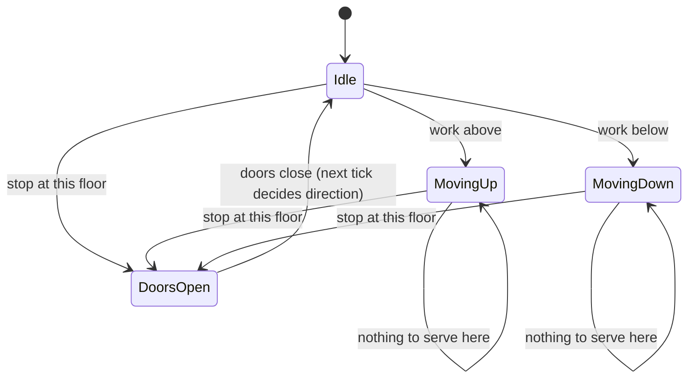
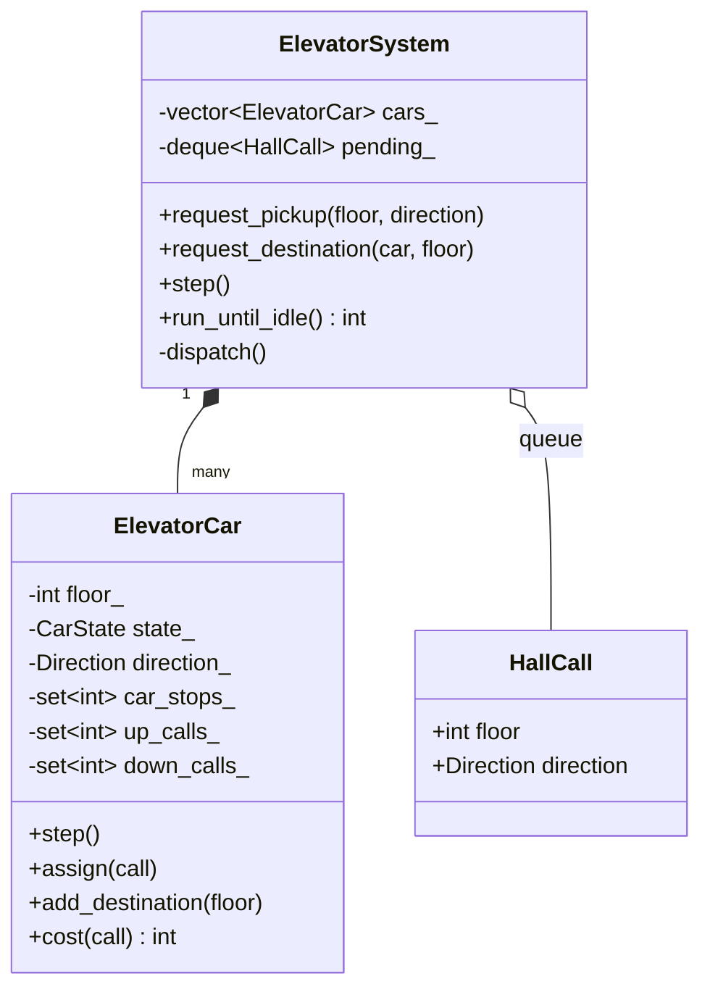

# Elevator system

A building with several elevator cars, hall buttons, car buttons, a dispatcher and SCAN scheduling, driven by a discrete-time simulation. Code: [elevator_system.hpp](elevator_system.hpp), tests: [elevator_system_test.cpp](elevator_system_test.cpp).

## Requirements

- Floors `lowest..highest`, `N` cars.
- **Hall call**: `request_pickup(floor, Up|Down)`. Calls go into a FIFO **request queue** and are assigned to a car on the next tick.
- **Car call**: `request_destination(car, floor)`.
- Each car serves stops with **SCAN** (the "elevator algorithm"): keep going in the current direction while there is work ahead, then reverse. On the way up it stops only for car stops and **up** hall calls. A **down** call is picked up at the top of the sweep, and the same rule applies going down.
- `step()` advances time by one tick. In one tick a car does exactly one thing: move one floor, open its doors, close its doors, or stay idle.
- Invalid floors and directions are rejected. Duplicate hall calls are merged.

## Car state machine



## Class diagram



## Key design points

- **State pattern (as an explicit state machine)**: `CarState` together with `ElevatorCar::step()` keeps the transitions in one place, so they are easy to test.
- **Dispatcher / cost function**: an idle car or a car already moving towards the call in the same direction costs `distance`. Any other car costs `distance + 2 * floors`, because it must finish its sweep first. Ties go to the lowest car id, which keeps the simulation deterministic.
- **Ordered sets** for stops make "any stop above/below?" O(1) through `begin()`/`rbegin()`, and keep stops de-duplicated.
- **Simulation step function**: time is explicit, so every test is deterministic.

## Complexity

With `C` cars, `F` floors and `Q` queued calls per tick:

| Operation | Time |
|---|---|
| `ElevatorCar::step` | O(log F) |
| `ElevatorSystem::step` | O(Q * C + C log F) |

## Tests

`elevator_system_test.cpp` checks the exact state sequence for one trip, the SCAN order versus the request order, finishing a sweep before reversing, down calls served on the way back, reversing at a down call, nearest-car and same-direction dispatch, merging duplicate calls, input validation, and a 3-car / 20-floor randomized simulation in which every request must be served.

```bash
mkdir -p build && g++ -std=c++17 -Wall elevator_system/elevator_system_test.cpp -o build/elevator_system_test && ./build/elevator_system_test
```
