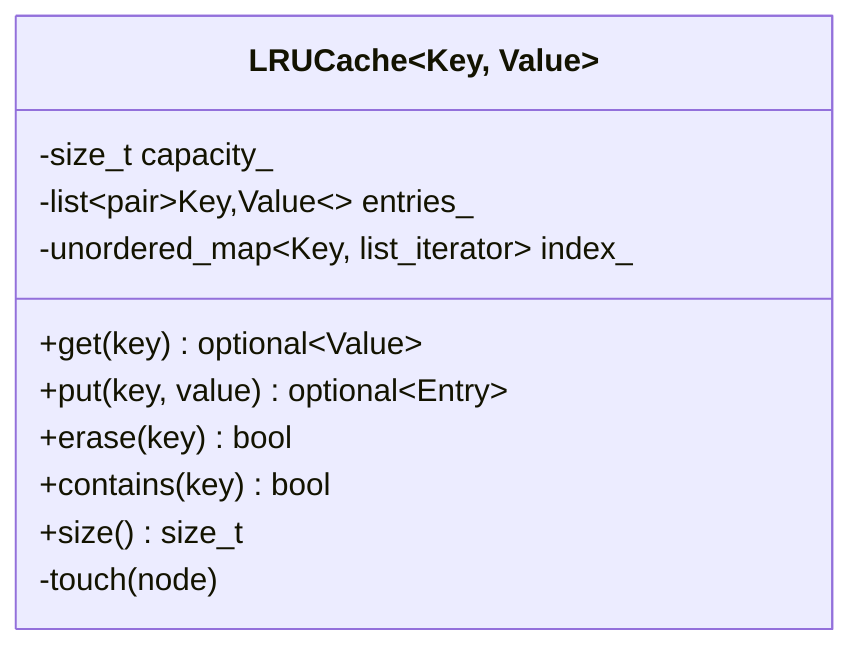

# LRU cache

A fixed-size cache that evicts the **least recently used** entry when it is full. Code: [lru_cache.hpp](lru_cache.hpp), tests: [lru_cache_test.cpp](lru_cache_test.cpp).

## Requirements

- `get(key)` returns the value (or nothing) and marks the key as most recently used.
- `put(key, value)` inserts or updates; when full, evicts the least recently used entry first.
- Both operations run in **O(1)**.
- Works for any key/value type (`LRUCache<Key, Value, Hash = std::hash<Key>>`).
- Capacity 0 is rejected. `put` returns the evicted entry so a caller can write it back somewhere.

## Class diagram



## How it works

```text
index_ (hash map)            entries_ (doubly linked list)
  key -> list node      MRU [ C ] <-> [ A ] <-> [ B ] LRU
```

- **Hit:** find the node through the map, then `std::list::splice` it to the front. Splice relinks the node without copying or invalidating iterators, so the map entry stays valid.
- **Miss on put:** if full, drop the back node (and its map entry), then push the new node to the front.

## Key design points

- **Hash map + doubly linked list**: the map gives O(1) lookup, the list gives O(1) reorder and eviction. Neither alone is enough.
- **Generic template** with a pluggable hash, like `std::unordered_map`.
- `contains` is a *peek* that does not change recency, which is useful for tests and metrics.

## Complexity

| Operation | Time | Notes |
|---|---|---|
| `get`, `put`, `erase`, `contains` | O(1) average | hash map lookups |
| Space | O(capacity) | one list node and one map entry per key |

## Tests

`lru_cache_test.cpp` covers hits and misses, eviction order, recency refresh on `get` and on update, capacity 1 and 0, and a 2000-step randomized comparison against a simple reference model.

```bash
mkdir -p build && g++ -std=c++17 -Wall lru_cache/lru_cache_test.cpp -o build/lru_cache_test && ./build/lru_cache_test
```
