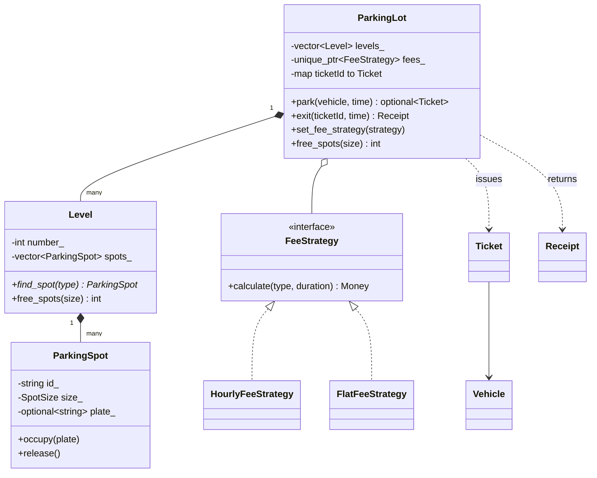

# Parking lot

A multi-level parking lot with spots sized for different vehicles, tickets on entry, and a fee charged on exit. Code: [parking_lot.hpp](parking_lot.hpp), tests: [parking_lot_test.cpp](parking_lot_test.cpp).

## Requirements

- The lot has several **levels**, each with **Small**, **Compact** and **Large** spots.
- Vehicles: **Motorcycle** (fits any spot), **Car** (Compact or Large), **Truck** (Large only).
- On entry, park the vehicle on the lowest level in the **smallest spot it fits** and issue a **ticket**. Return nothing when no spot fits.
- On exit, free the spot and return a **receipt** with the duration and fee.
- Pricing must be replaceable without changing the lot (hourly per vehicle type with a grace period, flat fee, ...).
- Reject: the same plate parking twice, unknown or reused tickets, exit time before entry time.

## Class diagram



## Key design patterns

- **Strategy**: `FeeStrategy` is an interface; `HourlyFeeStrategy` and `FlatFeeStrategy` are interchangeable and can be swapped at runtime with `set_fee_strategy` (for example, weekend pricing). The lot never knows how a fee is computed.
- **Composition**: lot -> levels -> spots. Each class owns only its own state (a spot knows who is parked, a level knows how to search its spots).
- **Best-fit allocation**: picking the smallest fitting spot keeps Large spots free for trucks.
- Money is an integer in the smallest currency unit, never a `float`.

## Complexity

With `L` levels and `S` spots per level:

| Operation | Time |
|---|---|
| `park` | O(L * S) linear scan for the best fit |
| `exit` | O(S) to find the spot on its level, O(1) ticket lookup |

For a very large lot, keep a free list (or a min-heap) per spot size per level to make `park` O(log n).

## Tests

`parking_lot_test.cpp` covers vehicle/spot compatibility, best fit, level overflow and a full lot, hourly rounding, the grace period, per-type rates, swapping the fee strategy, and the error cases (duplicate level numbers, missing rates, and an `exit` that fails during pricing must leave the vehicle parked).

```bash
mkdir -p build && g++ -std=c++17 -Wall parking_lot/parking_lot_test.cpp -o build/parking_lot_test && ./build/parking_lot_test
```
