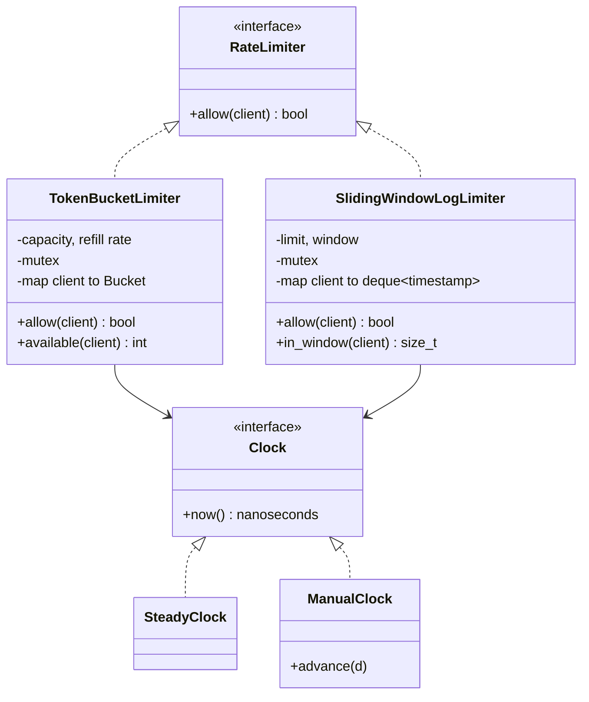

# Rate limiter

Two classic rate limiting algorithms behind one interface, keyed per client, thread-safe and testable with an injected clock. Code: [rate_limiter.hpp](rate_limiter.hpp), tests: [rate_limiter_test.cpp](rate_limiter_test.cpp).

## Requirements

- `allow(client)` returns `true` if the request may proceed, and records it.
- Separate limits per client key (user id, API key, IP).
- Two algorithms with the same interface:
  - **Token bucket**: bursts up to `capacity`, refilled at `refill_tokens` per `refill_period`.
  - **Sliding window log**: at most `limit` requests in any rolling `window`.
- Safe to call from many threads at once.
- Time comes from an injected `Clock`, so tests are deterministic (no `sleep`).

## Class diagram



## Key design patterns

- **Strategy / common interface**: callers depend on `RateLimiter`, so the algorithm can change without touching them.
- **Dependency injection** of `Clock`: production uses `SteadyClock`, tests use `ManualClock` and move time by hand.
- **Thread safety**: one `std::mutex` per limiter guards the per-client map. That is simple and correct. Under heavy load, shard the map (N mutexes chosen by `hash(client) % N`) to reduce contention.
- **Exact arithmetic**: the token bucket stores credit in "token-nanoseconds", so fractional rates like 3 tokens per second never drift through floating point rounding. Long idle times are clamped before multiplying, so nothing overflows.

## Trade-offs

| | Token bucket | Sliding window log |
|---|---|---|
| Bursts | Allowed up to `capacity` | Never more than `limit` in any window |
| Memory per client | O(1) | O(limit) timestamps |
| Accuracy | Average rate | Exact over any window, with no boundary burst (unlike a fixed window counter) |

## Complexity

| Operation | Time |
|---|---|
| Token bucket `allow` | O(1) |
| Sliding window `allow` | O(1) amortized: each timestamp is pushed and popped once |

## Tests

`rate_limiter_test.cpp` covers bursts, refill timing to the millisecond, the capacity cap after a very long idle time, fractional rates, independent clients, rolling window eviction, the fixed-window boundary case, both limiters through the interface, and an 8-thread contention test that must allow exactly `capacity` requests. That test is also clean under ThreadSanitizer.

```bash
g++ -std=c++17 -Wall rate_limiter/rate_limiter_test.cpp -o build/rate_limiter_test && ./build/rate_limiter_test
```
